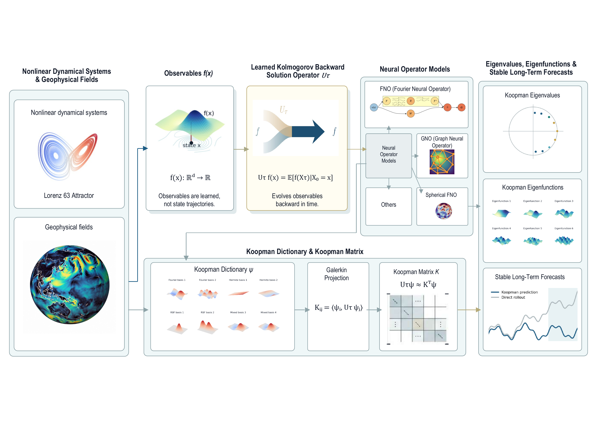

# Neural Operators Meet Kolmogorov Backward Operators

This repository implements neural approximations of Kolmogorov backward
solution operators and their finite-dimensional BSO projections for
forecasting and spectral analysis. Six benchmarks cover stochastic,
chaotic, geophysical, and real observational systems.

## Method overview

[](bso_schematic.pdf)

The image links to the full-resolution PDF.

## Quick start

Use Python 3.11 and install the core dependencies:

```bash
python -m pip install jupyterlab numpy==1.26.4 scipy==1.14.1 matplotlib==3.10.1 mne==1.8.0 torch==2.5.1 neuraloperator==1.0.2 pytest
```

Then start Jupyter from the repository root:

```bash
jupyter lab
```

CUDA is optional. `project_paths.py` resolves `data/`, `results/`, and
`figures/` relative to the repository root, so no machine-specific path edits
are required. The reference environment, experiment-specific dependencies,
fixed configurations, numerical results, and interpretation limits are
documented in [experimental_detail.md](experimental_detail.md).

## Experiments

| Notebook | Experiment |
|---|---|
| [nb_ou.ipynb](nb_ou.ipynb) | Ornstein–Uhlenbeck spectral validation |
| [nb_triple_well.ipynb](nb_triple_well.ipynb) | Triple-well metastable spectral analysis |
| [nb_lorenz63.ipynb](nb_lorenz63.ipynb) | Lorenz-63 forecasting |
| [nb_lorenz96.ipynb](nb_lorenz96.ipynb) | Lorenz-96 forecasting |
| [nb_sst.ipynb](nb_sst.ipynb) | Global SST forecasting and rollout stability |
| [nb_eeg.ipynb](nb_eeg.ipynb) | Resting-state EEG forecasting |

## Reproducibility

All six notebooks execute from a clean checkout. The Ornstein–Uhlenbeck and
triple-well notebooks recompute their experiments; the EEG notebook also
recomputes after downloading its public record on the first run. Lorenz-63,
Lorenz-96, and SST display committed reference outputs when their large,
ignored numerical artifacts are unavailable.

## Repository layout

- `experiments/<name>/`: experiment-specific implementations.
- `nb_*.ipynb`: notebook entry points.
- `figures/`: versioned publication figures.
- `edmd_bso_method.py`, `kbe_observation_data.py`: shared learning and data utilities.
- `solver_edmd.py`, `solver_resdmd.py`: finite-dimensional spectral solvers.
- `plotting_utils.py`, `project_paths.py`: shared plotting and path utilities.
- `tests/`: model, metric, protocol, and stability tests.

## Tests

```bash
python -m pytest -q
```

Raw data, checkpoints, and runtime results under `data/` and `results/` are
ignored by Git.
